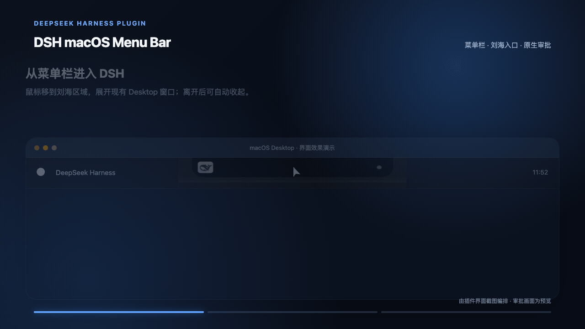

# DSH macOS Menu Bar

English | [简体中文](README.md)

[](https://dsh-plugin.org/plugins/amoswzw/dsh-macos-menu-bar)

Open DeepSeek Harness Desktop from the macOS menu bar, with native prompts when approval is needed. The plugin reuses your existing Desktop window, so sessions, drafts, and scroll position are preserved. A hover entry point and approval cards around the MacBook notch are also available.



## Install

Requires **macOS**, **Node.js 22+**, and **DeepSeek Harness Desktop `>=0.2.2-rc.3`** (verified on `0.2.2-rc.5`).

1. Quit DeepSeek Harness Desktop completely.
2. Run:

   ```sh
   "/Applications/DeepSeek Harness.app/Contents/Resources/runtime/cli/bin/dsh" plugin --profile desktop add @amoswzw/dsh-macos-menu-bar
   ```

3. Reopen Desktop. The menu bar icon appears automatically.

> Keep `--profile desktop` (Desktop only). If the app is installed outside `/Applications`, adjust the path at the start. To install the latest source from GitHub, swap the package name for `github:amoswzw/dsh-macos-menu-bar` — no build step needed.

<details>
<summary>Update / uninstall</summary>

```sh
# Update
".../bin/dsh" plugin --profile desktop update @amoswzw/dsh-macos-menu-bar

# Uninstall
".../bin/dsh" plugin --profile desktop remove @amoswzw/dsh-macos-menu-bar
```

Quit and reopen Desktop afterward. Uninstalling keeps your settings in `~/.dsh/macos-menu-bar.json` (or `$DSH_HOME/` if `DSH_HOME` is set).

</details>

## Use

- **Click** the menu bar icon to show / hide the Desktop window; **right-click** to open the full window or quit.
- Open **Menu Bar & Island** in the Desktop sidebar to configure the window size, hover entry point, approval cards, and language.
- Status light: **blue** for running tasks, **green** for completion, **orange** for pending approval (takes priority).
- With automatic hiding enabled, viewing completed tasks hides the island when no tasks or approvals remain. New tasks bring it back; notch hover still works while hidden.
- The native notch panel needs Xcode Command Line Tools; the menu bar entry still works without them or if compilation fails.

## yabai compatibility

If yabai expands the popup, add this at the end of your yabai configuration (usually `~/.config/yabai/yabairc`):

```sh
yabai -m rule --add label=dsh-macos-menu-bar app="^DeepSeek Harness$" manage=off
yabai -m rule --apply dsh-macos-menu-bar
```

Run both commands in a terminal to apply immediately. DSH popups and the full window will float; other apps are unaffected. The plugin does not edit your yabai configuration automatically.

## Development

Run tests with `npm test`. The plugin uses Desktop's Node inspector to add menu bar behavior without changing the app bundle or signature. An independent community project, not an official DeepSeek product.

[MIT License](LICENSE) © 2026 Amos W (amoswzw).
