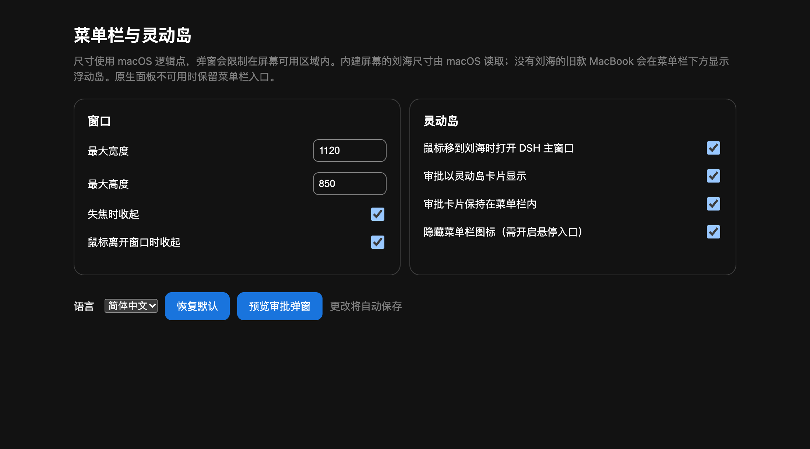
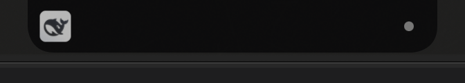

# DSH macOS Menu Bar

DeepSeek Harness Desktop menu bar and notch plugin for macOS. The plugin reuses the existing Desktop window and can show approval requests in a native dialog or notch card.

一个可安装到 DeepSeek Harness Desktop profile 的 macOS 插件。它把**现有 Desktop 窗口**作为菜单栏弹出窗口使用，因此会话、草稿、滚动位置和所有 Desktop 页面都留在同一个渲染进程里。需要审批时，插件默认显示 macOS 原生确认框；拒绝是默认选择。安装后从 Finder、Dock 或应用图标正常启动，插件会自动创建菜单栏图标并隐藏 Desktop 的 Dock 图标。

这是独立的社区插件，并非 DeepSeek 官方产品。插件运行时读取用户已安装的 Desktop 图标；仓库和发布包不包含 DeepSeek 的图标文件。

插件类别：**UI & Experience**。仅支持 macOS 的 **Desktop** profile；请勿按 Web profile 的通用安装示例安装。


动画由插件界面截图编排；其中审批卡片是预览，选择按钮不会授权任务。

## 截图

配置页（使用本仓库设置页和示例配置渲染，不包含会话侧栏）：



内建刘海上的空闲状态岛：



菜单栏内的紧凑审批预览（示例按钮不会授权任务）：


## 兼容性与安装

需要 macOS、DeepSeek Harness Desktop `>=0.2.2-rc.3 <0.2.3`。先完全退出正在运行的 Desktop，再从 GitHub 安装包含语言切换的当前源码：

```sh
DSH_CLI="/Applications/DeepSeek Harness.app/Contents/Resources/runtime/cli/bin/dsh"
"$DSH_CLI" plugin --profile desktop add github:amoswzw/dsh-macos-menu-bar
open -a "/Applications/DeepSeek Harness.app"
```

克隆仓库后，也可运行 `./install.sh`；脚本默认从 GitHub 源码安装。传入包名可改用 npm，例如 `./install.sh @amoswzw/dsh-macos-menu-bar@0.1.0`；传入 `.` 则从本地仓库安装。如果 DSH 安装在其他位置，可设置 `DSH_CLI=/path/to/dsh`。脚本只安装插件，不会自动重启正在运行的 Desktop。

已发布的 npm `0.1.0` 可用 `"$DSH_CLI" plugin --profile desktop add @amoswzw/dsh-macos-menu-bar@0.1.0` 安装，但它早于语言切换功能。也可把 GitHub 来源固定到某次提交：`github:amoswzw/dsh-macos-menu-bar#<commit-sha>`。安装一次即可；以后从 Finder、Dock、Spotlight 或 `open -a` 正常启动。插件在 Host 加载时自动注入主进程。若设置了 `DSH_HOME`，安装命令会使用对应的 Desktop profile。安装后若仍看到旧窗口行为，请完全退出并重开 Desktop。

English quick start: this plugin requires macOS and DeepSeek Harness Desktop `>=0.2.2-rc.3 <0.2.3`. Quit Desktop completely, run the GitHub installation commands above, and reopen the app. Open **Menu Bar & Island** in the DSH sidebar to choose **Follow system**, **English**, or **简体中文**. The npm `0.1.0` release predates the language selector.

卸载：

```sh
"$DSH_CLI" plugin --profile desktop remove @amoswzw/dsh-macos-menu-bar
```

卸载后也要完全退出并重开 Desktop。设置保存在 `$DSH_HOME/macos-menu-bar.json`（未设置 `DSH_HOME` 时在 `~/.dsh/macos-menu-bar.json`）；卸载命令不会删除这份个人设置。

仓库还提供显式启动命令，适合调试或在插件自动注入不可用时查看错误。它需要 Node.js 22+：

```sh
"$HOME/.dsh/profiles/desktop/node_modules/.bin/dsh-macos-menu-bar" "/Applications/DeepSeek Harness.app"
```

左键点击菜单栏图标可显示或隐藏同一个 Desktop 窗口。弹窗显示期间会临时加入所有 macOS Space，以便从当前桌面打开；收起后恢复原窗口的 Space 属性。右键提供“打开完整窗口”和“退出”。弹出窗口失焦时自动隐藏，任务继续运行。工具审批框提供“拒绝”“查看详情”“允许一次”；“查看详情”打开完整 Desktop 页面并交还给原有审批界面。应用访问等使用 DSH `user-questions` 审批意图的请求也会弹出原生确认框。允许一次只答复当前请求；取消或通信失败不会授权。

在 DSH 左侧栏打开 **菜单栏与灵动岛** 配置页，可设置弹窗最大宽高、失焦收起、鼠标离开收起、刘海悬停打开主窗口、审批卡片、菜单栏内紧凑审批、隐藏菜单栏图标及语言。界面支持简体中文和英语，默认跟随 macOS 语言，也可手动选择；设置页、菜单栏菜单、审批预览和插件自身的审批文案会一起切换。更改会自动保存，恢复默认也会立即应用。尺寸按 macOS 逻辑点计算，并按当前屏幕可用区域限制；默认最大宽高为 1120 × 850。原生 AppKit 面板读取内建屏幕的安全区与刘海两侧区域；有刘海时紧贴屏幕顶边，没有刘海的旧款 MacBook 显示在菜单栏下方。鼠标移到刘海黑色岛的任一可见位置会直接弹出原来的 Desktop 主窗口；只有审批请求才展开刘海审批卡片。刘海左侧显示 DeepSeek 图标，工作或等待审批时图标会轻微呼吸；右侧指示灯空闲时为灰色，Agent 工作时蓝色呼吸，等待审批时橙色呼吸。隐藏菜单栏图标需要同时开启悬停入口、使用内建屏幕作为主屏，而且原生面板必须可用。设置保存在 `$DSH_HOME/macos-menu-bar.json`，不修改其他插件的配置。

配置页中的“预览审批弹窗”会打开一张示例卡片，供检查位置和样式；预览选择不会授权任务。开启菜单栏内紧凑审批后，标题与请求摘要显示在刘海左侧、按钮显示在右侧，卡片不会进入工作区；长按钮文字可悬停查看完整标签。多个会话同时请求审批时，卡片按收到的顺序逐条显示，并标出等待数量；已取消的请求会从队列移除。

原生刘海面板在插件启动时使用系统 `clang++` 编译，并缓存到用户目录。使用刘海面板需要可用的 Xcode Command Line Tools；若编译或加载失败，菜单栏图标继续可用。默认不开启悬停和审批卡片；普通 macOS 审批框仍是默认样式。设置页及其 API 只接受本机连接，远程访问 DSH 的用户不能更改这台 Mac 的菜单栏设置。

## 维护与发布

本仓库已经是 DSH bundle：`package.json` 的 `dsh.bundle.patch` 指向 `cordis.patch.yml`，其中插入 Host 插件行。DSH 官方的[打包与安装说明](https://github.com/deepseek-ai/deepseek-harness/blob/master/docs/user/develop/basic/publish.md)说明，`dsh plugin --profile desktop add` 会把 bundle 加进 Desktop profile。源码全部是运行入口，不依赖安装期 `prepare` 或构建脚本；原生面板源码在运行时编译。

发布前在仓库目录执行：

```sh
npm test
npm pack --dry-run
"$DSH_CLI" plugin --profile desktop list --depth 0
```

`DSH_CLI` 的值见上面的安装示例。请确认 `npm pack --dry-run` 包含 `cordis.patch.yml`、`install.sh`、`index.mjs`、`client.js`、注入脚本、设置页、`native/` 源码和公开截图，且没有用户数据或调试截图。Desktop profile 由 Electron 管理，不能用普通 `dsh --profile desktop --dump-config` 检查；上面的 `plugin list` 用于核对已安装依赖。若要检查 bundle 配置层，可在独立的非 Desktop 测试 profile 中执行 `dsh --profile <test-profile> --dump-config`。

推送源码后，可从固定提交安装测试：

```sh
"$DSH_CLI" plugin --profile desktop add github:amoswzw/dsh-macos-menu-bar#<commit-sha>
```

`0.1.0` 已发布在 [npm](https://www.npmjs.com/package/@amoswzw/dsh-macos-menu-bar)。以后发布新版本时先提高 `package.json` 版本号、运行测试和打包检查，再执行 `npm publish --access public`；npm 不允许重新发布同名同版本。官方[插件索引文档](https://github.com/deepseek-ai/deepseek-harness/blob/master/docs/user/guide/plugin-market.md)还提供可选的 Discover 索引发布方式；GitHub 或 npm 发布本身不要求创建索引。

## 实现

普通启动时，Host 插件向自己的 Desktop 主进程发送 `SIGUSR1`，连接其临时 Node inspector，核对 PID，注入菜单栏逻辑，然后关闭 inspector。显式启动命令则在 `127.0.0.1` 上临时打开一个随机 inspector 端口，完成相同的注入。两种方式都不修改 `app.asar` 或应用签名。注入逻辑在只有当前用户可访问的临时目录中创建 Unix socket；DSH Host 插件通过这个 socket 请求原生审批框。主进程对每个请求验证随机令牌。卸载插件或退出应用会移除菜单栏和 socket。

这依赖 Desktop 发行版保留 Electron 的 Node inspector。若未来发行版关闭该功能，自动注入会记录警告并保留普通 Desktop；显式启动命令会明确报错。安装后请重启已经运行的 Desktop，使 Host 加载插件。临时 inspector 端口会短暂接受本机连接，因此只在可信任的本机用户环境中使用。

运行时插件会控制现有 Desktop 窗口、读取鼠标位置和显示器尺寸，并在需要时通过本机 `clang++` 编译原生面板。插件自身不连接第三方服务；安装 GitHub 版本时，DSH 的包管理器会从 GitHub 下载源码。设置页和本机 IPC 不对远程客户端开放。

## 开发

```sh
node --test test/*.test.mjs
```

若本机另有 Electron 开发版，可运行隔离的注入探针：

```sh
ELECTRON_BINARY=/path/to/Electron.app/Contents/MacOS/Electron \
DSH_APP_ICON=/path/to/icon.png node test/probe-inspector.mjs
```

探针只运行仓库内的空 Electron fixture，不会启动个人的 DSH profile；它验证 inspector 注入和 IPC。已在本机安装的 Desktop 上验证普通启动、菜单栏、侧边栏配置页、Shader 页面布局、顶部中央悬停及图标隐藏。

## 已知限制

- 已显示的原生审批框无法通过 Electron 的 message box API 从 Host 侧关闭。请求取消后插件立即返回取消，迟到的点击不会授权。
- 安装后需要完全退出并重新启动 Desktop；已经运行的主进程不会自动加载新插件。
- 原 Desktop 窗口的最小尺寸为 520 × 600 点；可用区域比这个尺寸更小时，系统可能无法把整个窗口放入屏幕。
- 原生刘海审批卡片已在安装的 Desktop 进程中显示并验证收起按拒绝结算；真实 DSH 工具审批尚未端到端触发。
- 原生刘海面板需要本机能运行 `clang++`；缺少 Xcode Command Line Tools 时，菜单栏入口继续工作，开启刘海审批后会回退到 Electron 卡片，顶部悬停仍使用屏幕中央的命中区域。
- 插件依赖 DSH Desktop 当前的 Electron 主进程结构和 Node inspector。DSH 更新后应先在兼容版本上复测；`engines.dsh` 目前只声明 0.2.2-rc.3 至 0.2.2，尚未声明支持 0.2.3 及以后版本。

## 许可证

[MIT](LICENSE) © 2026 Amos W (amoswzw)。
