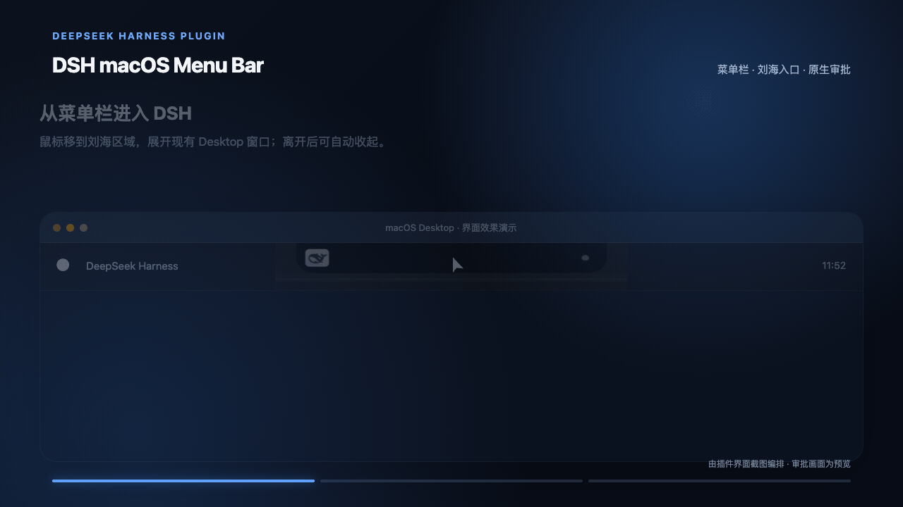

# DSH macOS Menu Bar

[English](README.en.md) | 简体中文

[](https://dsh-plugin.org/plugins/amoswzw/dsh-macos-menu-bar)

从 macOS 菜单栏一键呼出 / 收起 DeepSeek Harness Desktop，审批时弹出原生提示。复用现有 Desktop 窗口，会话、草稿和滚动位置都不会丢；还支持刘海悬停入口和审批卡片。



## 安装

需要 **macOS**、**Node.js 22+** 和 **DeepSeek Harness Desktop `>=0.2.2-rc.3 <0.3`**（在 `0.2.2-rc.5` 上实测通过）。

1. 完全退出 DeepSeek Harness Desktop。
2. 运行：

   ```sh
   "/Applications/DeepSeek Harness.app/Contents/Resources/runtime/cli/bin/dsh" plugin --profile desktop add @amoswzw/dsh-macos-menu-bar
   ```

3. 重新打开 Desktop，菜单栏图标会自动出现。

> 请保留 `--profile desktop`（仅支持 Desktop）。若应用不在 `/Applications`，把命令开头的路径改成实际位置。想装 GitHub 最新源码，把包名换成 `github:amoswzw/dsh-macos-menu-bar` 即可，无需构建。

<details>
<summary>更新 / 卸载</summary>

```sh
# 更新
".../bin/dsh" plugin --profile desktop update @amoswzw/dsh-macos-menu-bar

# 卸载
".../bin/dsh" plugin --profile desktop remove @amoswzw/dsh-macos-menu-bar
```

操作后完全退出并重开 Desktop。卸载会保留 `~/.dsh/macos-menu-bar.json`（设置了 `DSH_HOME` 则在 `$DSH_HOME/` 下）中的个人设置。

</details>

## 使用

- **点击**菜单栏图标：显示 / 收起 Desktop 窗口；**右键**：打开完整窗口或退出。
- 在 Desktop 左侧栏打开 **菜单栏与灵动岛**，配置窗口大小、悬停入口、审批卡片和语言。
- 状态灯：**蓝色**执行中、**绿色**已完成、**橙色**等待审批（优先显示）。
- 开启自动隐藏后，查看完成结果且无任务或审批时，灵动岛隐藏；新任务开始时重新显示，隐藏时仍支持刘海悬停。
- 刘海原生面板需要 Xcode Command Line Tools；缺失或编译失败时菜单栏入口不受影响。

## yabai 兼容

若弹窗被 yabai 自动放大，在 yabai 配置文件（通常为 `~/.config/yabai/yabairc`）末尾添加：

```sh
yabai -m rule --add label=dsh-macos-menu-bar app="^DeepSeek Harness$" manage=off
yabai -m rule --apply dsh-macos-menu-bar
```

在终端执行这两条命令可立即生效。DSH 弹窗和完整窗口都会保持浮动，其他应用不受影响。插件不会自动修改 yabai 配置。

## 开发

运行测试：`npm test`。插件通过 Desktop 的 Node inspector 注入菜单栏逻辑，不修改应用包或签名。社区维护项目，非 DeepSeek 官方产品。

[MIT 许可证](LICENSE) © 2026 Amos W (amoswzw)。
